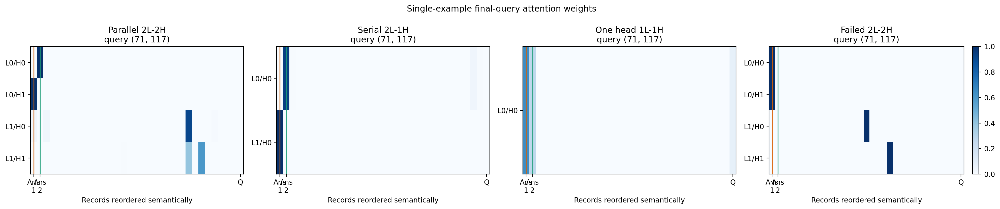
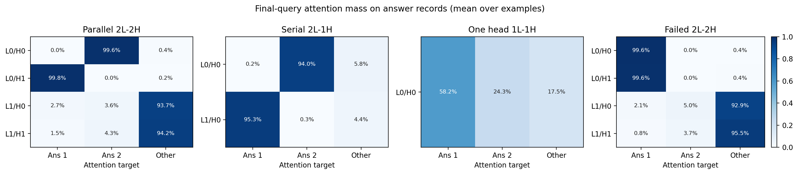
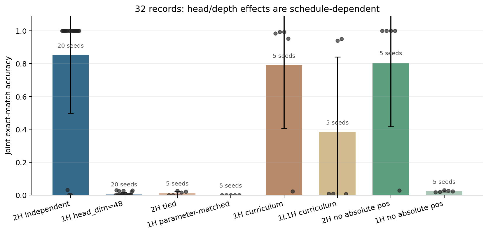
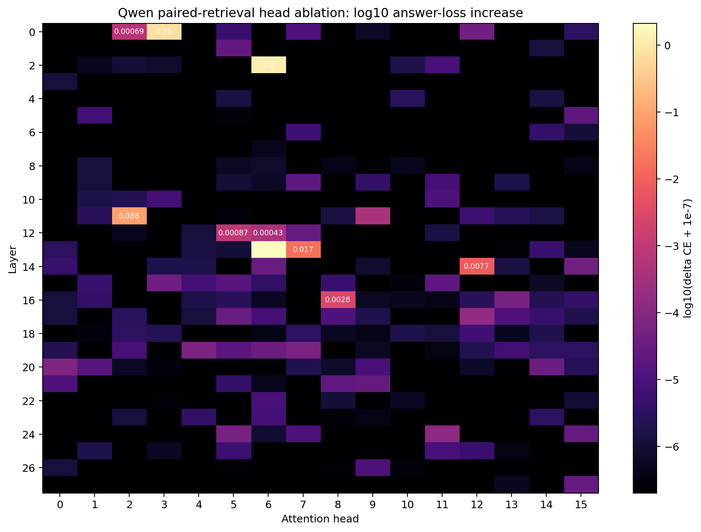

# Parallel Heads or Serial Depth?

## The question

What happens when a model must retrieve **two different items at the
same time, does a Transformer need two attention heads for two independent lookups?

The short answer is no. Two heads are often much easier to train, but a single
head can also solve the task through either depth or a multi-peaked attention
distribution.

## The task

Each example contains a shuffled table of key-value records:

```text
k17 -> v42
k03 -> v09
k28 -> v71
k55 -> v13
...

query  = (k17, k03)
answer = (v42, v09)
```

The model must return both values. This is scored by **joint exact match**: if
either value is wrong, the example is wrong.

Every batch generates a new table. Keys and values are unique within an
example, records are shuffled, and no position or frequency cue identifies the
answers. The model therefore has to read the requested records rather than
memorize fixed associations or use shortcuts.

## The model

The model is deliberately small:

- each key and value has its own learned embedding;
- every record becomes one token containing its key and value identity;
- a final query token stores the requested keys in two separate slots;
- one or two Transformer blocks process the table and query;
- two answer heads read the final query token and predict the two values.

In this setting, a **head** is one softmax distribution over the context
tokens. A **layer** is one attention operation followed by an MLP.

I varied one architectural resource at a time:

- one vs. two heads;
- one vs. two layers;
- MLP on or off;
- one head with the same width as two heads;
- fixed training vs. a curriculum that gradually increases the number of records.

## How I checked the learned mechanism

First, **swapped the two queries**. A real two-query solution should swap its
two answers.

Second, **ablated one head** by removing its output. If each head carries one
answer, removing head 0 should break answer 1 while leaving answer 2 intact,
and vice versa.

Third, I performed **activation patching**: I ran the model on a swapped-query
example, copied one head's output back into the original run, and observed
which answer changed.

For the visualizations, I focus on post-softmax attention weights rather than
raw `W_Q`, `W_K`, or `W_V` matrices. Hidden dimensions can be rotated or
permuted without changing the computation, while attention weights directly
show which records a head reads.

## Result 1: the fixed schedule looked like a necessity result

With 32 records, a fixed training schedule, and 20 seeds:

| architecture | mean joint accuracy | successful seeds |
|---|---:|---:|
| 2 layers, 2 independent heads | 85.15% | 17/20 |
| 2 layers, 1 matched head | 0.62% | 0/20 |

A parameter-matched one-head model also succeeded on 0/5 seeds. The successful
two-head models were strongly bimodal: they either reached nearly 100% or
learned only one answer.

The successful models were easy to interpret. One first-layer head selected the
record for answer 1, the other selected the record for answer 2, and removing
either head broke only its corresponding answer. At this point, it looked as
though two heads were necessary.

## Result 2: changing only the curriculum overturned that conclusion

I then changed only how quickly the model saw longer record lists: training
started with 16 records and grew to 32.

- A two-layer, one-head model succeeded on 4/5 seeds.
- A one-layer, one-head model reached 93.96% and 95.02% on 2/5 seeds.

The one-head models solved the same task through different mechanisms:

- **One head, two layers:** layer 0 handled one query and layer 1 handled the
  other, so the two retrievals happened serially across depth.
- **One head, one layer:** the single softmax developed two peaks. In one
  successful run it assigned 58.2% mass to the answer-1 record and 24.3% to
  the answer-2 record.

The attention heatmaps make the difference visible:



In the parallel model, the two first-layer heads form separate answer-selective
spikes. In the serial model, layer 0 selects answer 2 and layer 1 selects
answer 1. The one-head model produces two spikes in the same attention row.
The failed model puts both heads on answer 1, so answer 2 is never retrieved.

These patterns are not specific to one selected example:



Thus, the fixed-schedule result measures optimization reliability, not an
intrinsic limitation of one-head Transformers.



## Result 3: heads matter more as the number of queries grows

For one-layer models, the success pattern was:

| queries | 1 head | 2 heads | 3 heads | 4 heads |
|---|---:|---:|---:|---:|
| 3 | 0/5 | 3/5 | 5/5 | - |
| 4 | 0/5 | 0/5 | 1/5 | 5/5 |

With three queries, the three-head model was reliable. Each head selected one
answer record with roughly 98.5-98.8% attention mass, and removing a head
destroyed only its corresponding answer.

Two heads could still solve three queries on several seeds by making one head
carry two answer peaks. This is therefore a capacity and reliability effect,
not a strict “one query requires one head” theorem.

## Natural-language test

I translated the task to Qwen3-0.6B:

```text
Use only these facts:
- Priya reports to Jamal.
- Sofia reports to Sami.
- Mina reports to Hassan.
...

What are the report targets of Freya and Bilal, respectively?
Give exactly two names in the same order, separated by a comma.
```

One expected answer is `Uma, Orla`.

The base model solved 0/32 examples. After 300 LoRA steps, six independently
trained adapters averaged 99.87% strict exact match over 128 examples.
Performance remained essentially unchanged with held-out names, unseen
templates, 32-fact contexts, swapped queries, and unseen `supervises` wording.

## What the Qwen model actually learned

Qwen3-0.6B has 28 layers and 16 query heads per layer. I removed each of its
448 head outputs once and measured the resulting increase in answer-token loss.

Three heads stood out:

| intervention | exact-match accuracy |
|---|---:|
| no ablation | 100% |
| remove layer 13/head 6 | 19.53% |
| remove layer 2/head 6 | 41.41% |
| remove layer 0/head 3 | 35.94% |
| remove an unrelated head | 100% |
| remove all three | 0% |



This heatmap shows how much answer loss rises when each head is
removed.

The first two heads remained critical across adapters trained with seeds 1-4:
removing them left 10.94-25.00% and 34.38-48.44% accuracy, and removing all
three produced 0% every time. The same three-head ablation also produced 0%
on 32 facts, unseen templates, swapped queries, and unseen relation wording.

## Conclusion

The experiments do not prove that two heads are mathematically necessary for
two lookups. They support a narrower and more useful conclusion:

- heads improve optimization reliability and parallel capacity;
- a single head can encode multiple answers in a multi-peaked distribution;
- a single head can process answers sequentially across layers;
- extra heads become increasingly important as the number of independent
  queries grows;
- in Qwen, the learned paired-retrieval behavior is causally concentrated in a
  small, stable set of attention heads.

The most interesting next question is therefore: **under a fixed parameter and
computation budget, when does a Transformer prefer parallel heads, and when
does it prefer serial depth?**

